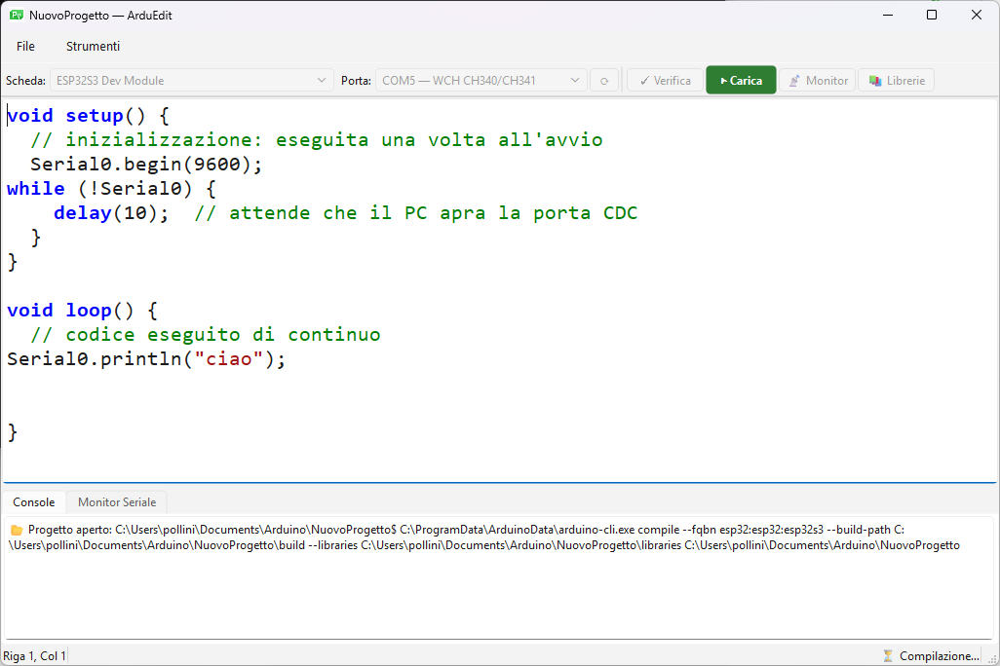

# ArduEdit

Editor essenziale per Arduino e schede compatibili, pensato per rendere più
semplici le attività di programmazione in classe.

## Scarica ArduEdit

Le versioni distribuite e i relativi pacchetti saranno disponibili nella pagina
[Releases di GitHub](https://github.com/OWNER/arduedit/releases/latest). Sostituisci
`OWNER` con il nome dell'account o dell'organizzazione GitHub che ospiterà il
repository. Nelle note della release trovi le istruzioni e i sistemi supportati
per quel pacchetto.

## Manuale utente

Consulta il [manuale di ArduEdit](docs/manuale.md) per installazione, primo
progetto, compilazione, caricamento sulla scheda, monitor seriale e librerie.